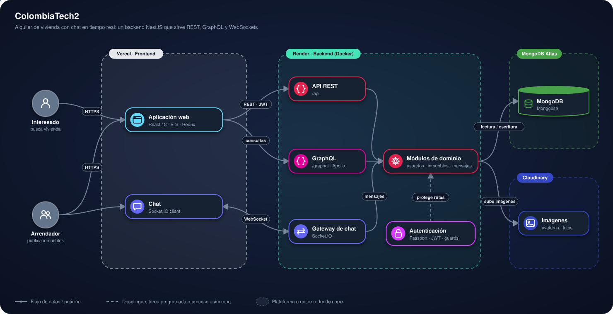

# Alquiler de vivienda (ColombiaTech2)

<p>
  <a href="https://colombia-tech2.vercel.app"></a>
  <a href="https://frontend-nine-topaz-99.vercel.app"></a>
  <a href="https://d4i3vsgw7xwmh.cloudfront.net"></a>
</p>


> 📘 **[Manual de usuario](docs/MANUAL.md)**: cómo usar cada pantalla, paso a paso y con imágenes.

## Contenido

1. [Presentación](#1-presentación)
2. [Funcionalidades](#2-funcionalidades)
3. [Arquitectura](#3-arquitectura)
4. [Estructura del proyecto](#4-estructura-del-proyecto)
5. [Instalación para pruebas](#5-instalación-para-pruebas)
6. [Autor y licencia](#6-autor-y-licencia)

---

## 1. Presentación

Plataforma de alquiler de vivienda en Colombia: quien publica sube los datos y la foto de la casa,
y quien busca explora el catálogo por departamento y ciudad y conversa en un chat en vivo.

- **Qué lo hace interesante:** un solo backend atiende tres formas de consumir los mismos datos
  (REST, GraphQL y WebSockets) sin duplicar lógica.
- **Cómo probarlo:** entra a la [demo](https://colombia-tech2.vercel.app), crea una cuenta y
  publica o busca una casa. La primera carga del día puede tardar hasta un minuto mientras el
  servicio se reactiva.

## 2. Funcionalidades

- Registro e ingreso con verificación en dos pasos obligatoria (app autenticadora o código por correo).
- Catálogo de casas en tarjetas, con búsqueda por ciudad, departamento, tipo o código.
- Publicación y edición de casas con foto; si no hay foto, se genera una ilustración automática.
- Chat general en tiempo real.
- Perfil, cambio de contraseña y métodos de verificación.
- Diseño adaptable a celular, tablet y computador, tema claro y oscuro, e instalable como aplicación.
- Pantalla propia de mantenimiento si el servicio no responde, que se recupera sola.

## 3. Arquitectura

<p align="center">
  
</p>

| Capa | Tecnología |
|---|---|
| Aplicación web | React 18, Vite, Redux Toolkit, React Router, Tailwind CSS |
| Backend | NestJS (REST, GraphQL code-first y WebSockets con Socket.IO) |
| Datos | MongoDB con Mongoose |
| Imágenes | Almacenamiento de imágenes en la nube |
| Despliegue | Frontend y backend se publican solos desde GitHub en cada cambio a `main` |

## 4. Estructura del proyecto

```
ColombiaTech2/
├── backend/          NestJS: REST, GraphQL y WebSockets
│   └── src/
│       ├── auth/     Ingreso y verificación en dos pasos
│       ├── users/
│       ├── houses/
│       ├── upload/   Carga de imágenes
│       └── messages/ Chat
└── frontend/         React + Vite + Redux Toolkit + Tailwind
    └── src/
        ├── components/
        └── features/ Estado global y consultas
```

## 5. Instalación para pruebas

Requisitos: Node.js 24, npm, una base MongoDB y una cuenta de almacenamiento de imágenes.

```bash
# Backend (terminal 1)
cd backend && npm install && cp .env-ejemplo .env && npm run start:dev

# Frontend (terminal 2)
cd frontend && npm install && cp .env.example .env && npm run dev
```

Las plantillas `.env-ejemplo` y `.env.example` indican qué variables completar. Nunca subas tu
`.env` al repositorio. El backend queda en `http://localhost:3000` y el frontend en
`http://localhost:5173`.

## 6. Autor y licencia

**Luis F. A.** · [GitHub](https://github.com/lariasca1994) · [LinkedIn](https://linkedin.com/in/lfac1)

Contacto: Telegram [@lfac6](https://t.me/lfac6) · WhatsApp [@carraian160](https://wa.me/carraian160) ·
[ariascluisf@hotmail.com](mailto:ariascluisf@hotmail.com)

Licencia: MIT.
