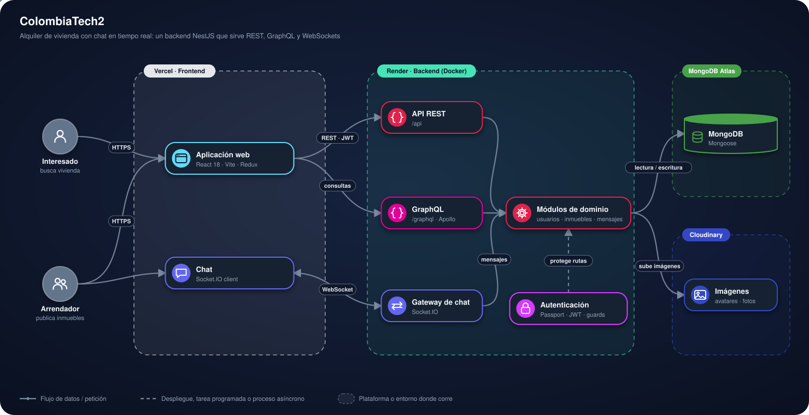

# ColombiaTech2

<p>
  <a href="https://colombia-tech2.vercel.app"></a>
  <a href="https://frontend-nine-topaz-99.vercel.app"></a>
  <a href="https://d4i3vsgw7xwmh.cloudfront.net"></a>
</p>


## Contenido

1. [Presentación](#1-presentación)
2. [Estructura del proyecto](#2-estructura-del-proyecto)
3. [Arquitectura](#3-arquitectura)
4. [Plataformas y su función](#4-plataformas-y-su-función)
5. [Cómo usar la plataforma](#5-cómo-usar-la-plataforma)
6. [Instalación para pruebas](#6-instalación-para-pruebas)
7. [Autor y licencia](#7-autor-y-licencia)

---

## 1. Presentación

Plataforma de alquiler de vivienda con chat en tiempo real entre interesado y
arrendador. Backend unificado en NestJS que expone REST, GraphQL y WebSockets
sobre la misma base de código, con frontend en React.

### En pocas palabras

- **Qué hace:** quien busca vivienda puede ver inmuebles publicados y hablar por
  chat, en tiempo real, con el arrendador. El arrendador publica sus inmuebles
  con fotos.
- **Qué lo hace interesante:** un solo backend atiende tres formas de consumir
  los mismos datos —REST, GraphQL y WebSockets— sin duplicar lógica.
- **Cómo probarlo:** entra a la [demo](https://colombia-tech2.vercel.app), crea
  una cuenta y publica o busca un inmueble. Para correrlo en tu equipo, ve a
  [Instalación para pruebas](#6-instalación-para-pruebas).

### Demo en vivo

- **Aplicación:** [colombia-tech2.vercel.app](https://colombia-tech2.vercel.app)
- **API REST:** `https://colombiatech2.onrender.com/api`
- **GraphQL Playground:** `https://colombiatech2.onrender.com/graphql`

> El backend corre en Render, que suspende el servicio tras
> un período de inactividad. La primera petición tras la suspensión puede
> tardar entre 30 y 50 segundos en responder mientras el servicio despierta.

### Funcionalidades

- Registro e inicio de sesión con JSON Web Tokens
- Publicación y consulta de inmuebles
- Carga de imágenes (avatares y fotos de inmuebles) con almacenamiento
  persistente en la nube
- Acceso restringido: cada usuario solo alcanza su propia información
- Chat en tiempo real mediante WebSockets
- Misma información disponible por REST y por GraphQL

### Stack

**Backend:** NestJS, MongoDB con Mongoose, GraphQL (Apollo, enfoque code-first),
Passport con JWT, Socket.IO

**Frontend:** React 18, Vite, Redux Toolkit, React Router, Tailwind CSS,
Socket.IO client

---

## 2. Estructura del proyecto

```
ColombiaTech2/
├── backend/          NestJS — REST, GraphQL y WebSockets
│   └── src/
│       ├── auth/     Autenticación JWT y guards
│       ├── users/
│       ├── houses/
│       ├── upload/   Carga de imágenes a Cloudinary
│       └── messages/ Gateway del chat
└── frontend/         React + Vite + Redux Toolkit + Tailwind
    └── src/
        ├── components/
        ├── pages/
        └── store/    Estado global con Redux Toolkit
```

---

## 3. Arquitectura

<p align="center">
  
</p>

Un único backend NestJS sirve las tres interfaces (REST, GraphQL y
WebSockets) sobre los mismos módulos de dominio, evitando duplicar lógica de
negocio entre capas.

---

## 4. Plataformas y su función

| Plataforma | Función en el proyecto |
|---|---|
|  | Sirve la aplicación React (Vite + Redux Toolkit + Tailwind) y el cliente de chat. |
|  | Corre el backend NestJS: las rutas REST (`/api`), GraphQL (`/graphql`) y el gateway de chat (Socket.IO) llegan a los mismos módulos de dominio, protegidos con JWT. Admite conexiones WebSocket persistentes. |
|  | Guarda usuarios, inmuebles y mensajes. |
|  | Almacena las imágenes: avatares de usuario y fotos de inmuebles. |
|  | Catálogo público de departamentos y ciudades para los selectores del formulario de inmuebles (sin registro ni clave). |

---

## 5. Cómo usar la plataforma

### 5.1 Crear una cuenta

1. Entra a la [demo](https://colombia-tech2.vercel.app) y, en el menú superior,
   elige **Crear Usuario**.
2. Completa el formulario:

   | Campo | Dato |
   |---|---|
   | Name | Nombre |
   | Lastname | Apellido |
   | Email | Correo con el que vas a iniciar sesión |
   | Password | Contraseña |
   | Avatar | Foto de perfil (PNG o JPG) |

3. Pulsa **Save**.

### 5.2 Iniciar sesión

1. Elige **Login** en la esquina superior derecha.
2. Ingresa **Email** y **Password** y pulsa **Iniciar Sesion**.
3. Al entrar, el menú cambia y muestra las secciones **🏠 Casas** y **💬 Chat**.

La sesión se cierra sola tras 4 horas sin actividad.

### 5.3 Publicar un inmueble

1. En **🏠 Casas**, elige **Crear casa**.
2. Completa el formulario:

   | Campo | Dato |
   |---|---|
   | Address | Dirección |
   | Department / City | Departamento y ciudad, desde listas desplegables |
   | Zip code | Código postal |
   | Size (m2) | Área en metros cuadrados |
   | Type | Tipo de inmueble (casa, apartamento, etc.) |
   | Rooms / Bathrooms | Número de habitaciones y baños |
   | Parking | Sí o No |
   | Price | Precio |
   | Code | Código que identifica el inmueble |
   | Imagen | Foto del inmueble (PNG o JPG) |

3. Pulsa **Save**.

### 5.4 Consultar, editar o eliminar inmuebles

1. En **🏠 Casas**, elige **Ver casas**: aparece una tabla con los datos y la foto
   de cada inmueble.
2. **Edit** abre el mismo formulario con los datos cargados.
3. **Delete** pide confirmación antes de eliminar el inmueble.

### 5.5 Chatear

1. En **💬 Chat**, elige **Ir al chat**.
2. Escribe en **Escribir mensaje...** y pulsa **Send**. Los mensajes llegan en
   tiempo real.

### 5.6 Perfil, contraseña y tema

- Pulsa tu avatar (arriba a la derecha) para abrir el menú de cuenta:
  - **Profile:** edita nombre, apellido, correo y avatar.
  - **Change Password:** pide la contraseña actual y la nueva dos veces.
  - **Logout:** cierra la sesión.
- El botón 🌙 / ☀️ alterna entre tema oscuro y claro.

### Si el servicio no responde

Si la API o la base de datos (MongoDB Atlas) no responden, la aplicación muestra una **pantalla de mantenimiento** con los colores del proyecto, en lugar de un error genérico o de una página que no carga.

- **Servidor:** Si MongoDB no está conectado, la API responde **503** al instante (con CORS) en vez de colgarse ~10 s y terminar en 500. Nuevo `GET /health`: 200 solo con la base arriba.
- **Pantalla:** Un middleware de Redux (`src/features/mantenimiento.js`) detecta fallos de las APIs propias (sin conexión o 502/503/504; la API externa de Colombia no cuenta) y `src/components/Mantenimiento.jsx` muestra la pantalla.
- **Recuperación:** Consulta `/health` cada 15 s y recarga la página sola cuando la API y la base vuelven. No reintenta acciones del usuario, para no duplicarlas.

---

## 6. Instalación para pruebas

### Requisitos

- Node.js 18 o superior
- npm
- Una instancia de MongoDB accesible
- Una cuenta de Cloudinary para la carga de imágenes

Backend y frontend se levantan por separado, en dos terminales.

### Backend

```bash
cd backend
npm install
cp .env-ejemplo .env
npm run start:dev
```

El `.env` requiere la cadena de conexión a MongoDB, un secreto para firmar los
tokens y las credenciales de Cloudinary. La plantilla indica el nombre de cada
variable.

Queda escuchando en `http://localhost:3000`.

- API REST bajo `/api`
- Consola de GraphQL en `/graphql`
- WebSocket del chat en la misma raíz

### Frontend

```bash
cd frontend
npm install
cp .env.example .env
npm run dev
```

El `.env` necesita la URL del backend. Queda en `http://localhost:5173`.

### Despliegue

El backend está preparado para Render y el frontend para Vercel. Ambos
requieren definir las mismas variables de entorno del `.env` en el panel del
proveedor.

---

## 7. Autor y licencia

> 📘 **[Manual de usuario](docs/MANUAL.md)**: cómo usar la plataforma campo por campo, qué datos se ingresan y qué garantiza en seguridad.

**Luis Felipe Arias Carriazo**
[GitHub](https://github.com/lariasca1994) · [LinkedIn](https://linkedin.com/in/lfac1)

Licencia: MIT.
