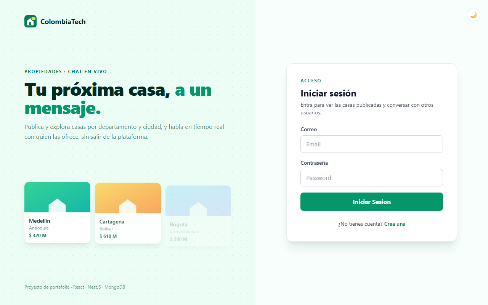
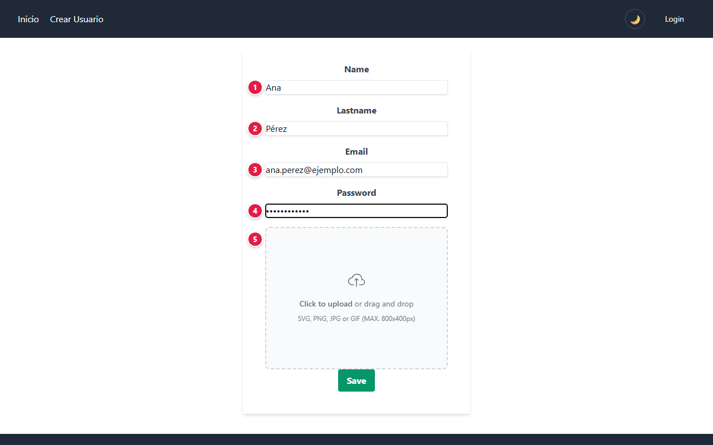
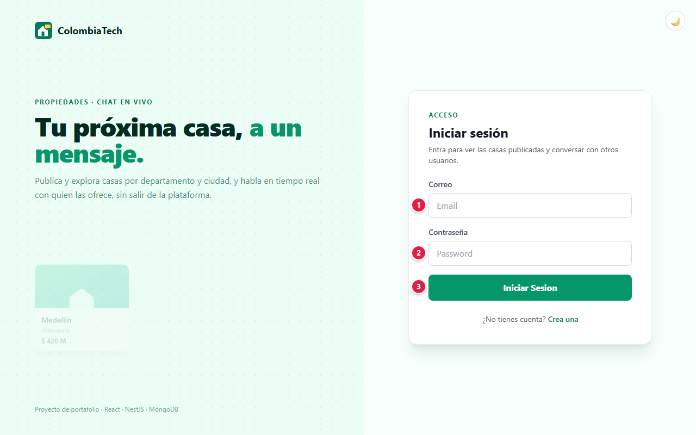
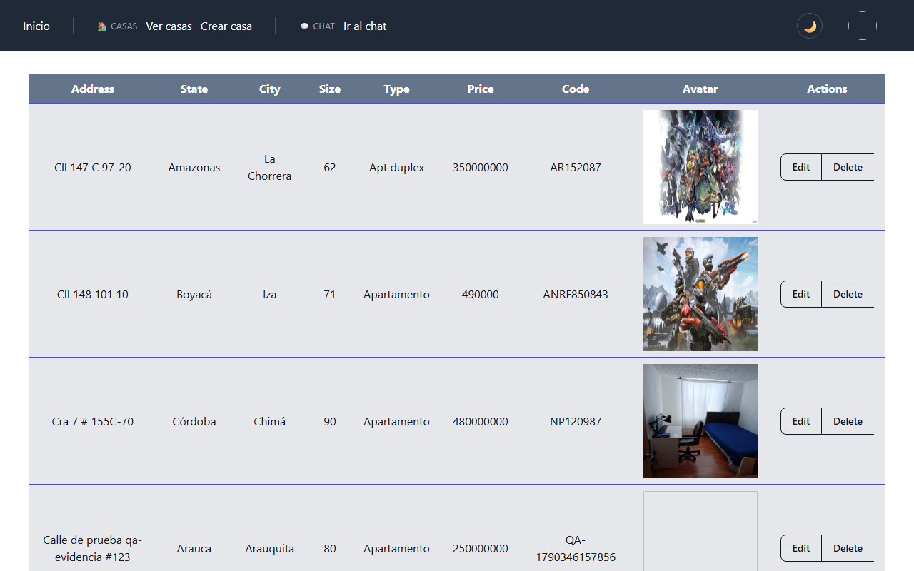
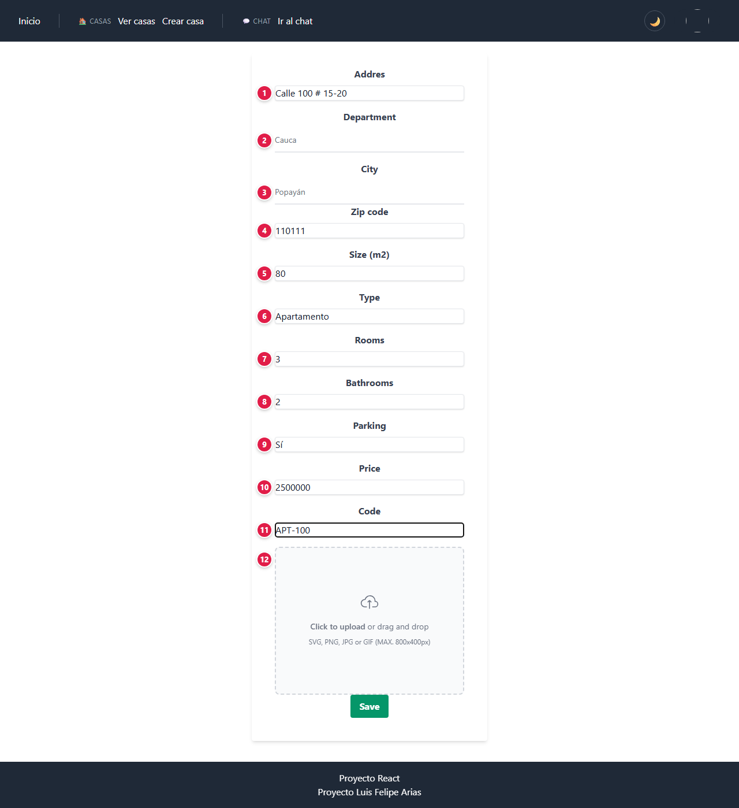
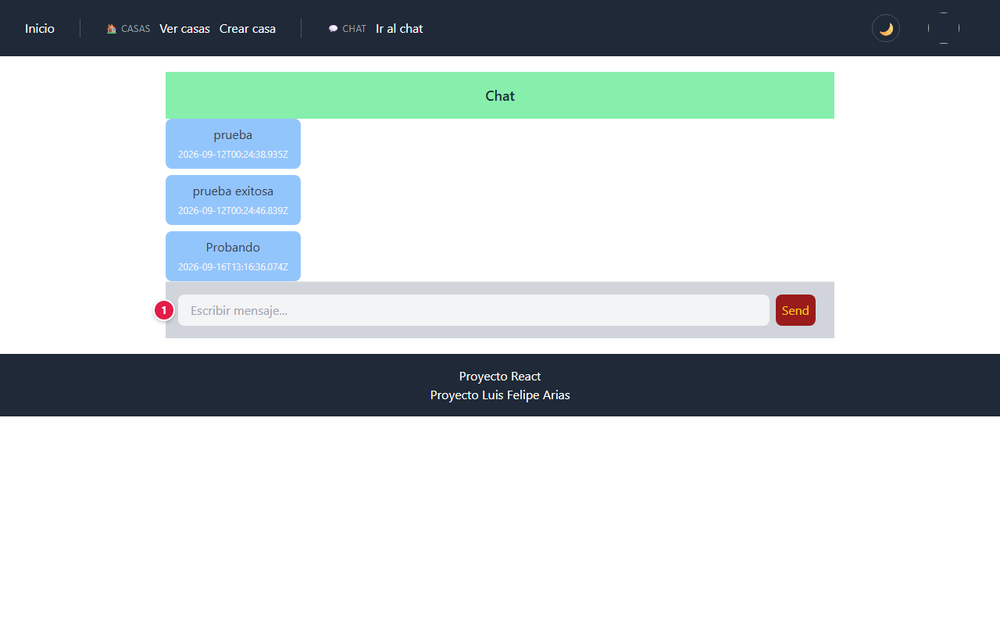
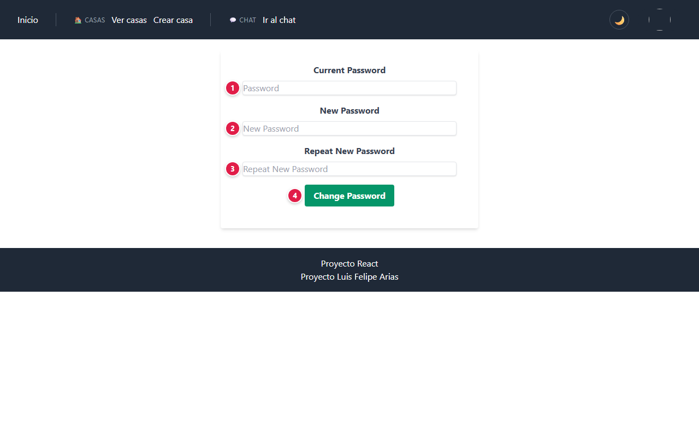

# 📘 Manual de usuario · ColombiaTech2

Guía para usar la plataforma paso a paso: qué significa cada campo, qué datos se ingresan y qué
protege la plataforma. Para la parte técnica vuelve al [README](../README.md).

**Demo:** [colombia-tech2.vercel.app](https://colombia-tech2.vercel.app)

## Contenido

1. [Proyecto: objetivos y alcances](#1-proyecto-objetivos-y-alcances)
2. [Glosario](#2-glosario)
3. [Plataformas, base de datos y servicios](#3-plataformas-base-de-datos-y-servicios)
4. [Paso a paso](#4-paso-a-paso)
5. [Seguridad: tu información protegida](#5-seguridad-tu-información-protegida)
6. [Agradecimientos](#6-agradecimientos)

---

## 1. Proyecto: objetivos y alcances

### Objetivo

Plataforma de alquiler de vivienda: los arrendadores publican inmuebles con foto y quienes buscan
vivienda los consultan y conversan en un chat en tiempo real.

### Alcance: qué necesitas y qué esperar

- Solo necesitas un navegador.
- El servidor se duerme sin uso: la primera acción del día puede tardar **entre 30 y 50 segundos**.
- Los textos de la interfaz están en inglés (Name, Address, Save…); este manual los traduce.

### Límites

Es una demo de portafolio:

- **El chat es una sala general** y su conexión en tiempo real no exige sesión: no compartas
  teléfonos, documentos ni datos personales por ese medio.
- Los inmuebles publicados son visibles para todas las personas con cuenta: publica datos de
  ejemplo, no tu dirección real.
- El token se guarda en `localStorage`; cierra sesión con **Logout** en equipos compartidos.
- El registro no verifica el correo: para recuperar la cuenta con **¿Olvidaste tu contraseña?**,
  regístrate con un correo al que tengas acceso.

## 2. Glosario

Palabras técnicas que aparecen en este manual, explicadas en lenguaje simple.

| Término | Qué significa |
|---|---|
| **Administrador** | Cuenta con permisos para gestionar usuarios y configuraciones de la aplicación. |
| **API** | Puerta de entrada de un programa para que otros programas le pidan o le envíen datos. |
| **Arranque en frío** | Los servidores gratuitos se apagan sin uso; la primera visita tarda unos segundos mientras vuelven a encenderse. |
| **Backend** | La parte de la aplicación que trabaja "detrás": procesa lo que envías y habla con la base de datos. |
| **Base de datos** | Lugar donde la aplicación guarda la información de forma ordenada y permanente. |
| **Contraseña cifrada (hash)** | La contraseña no se guarda tal cual, sino como una "huella" de la que no se puede recuperar el texto original. |
| **CORS** | Regla que impide que páginas ajenas usen la API de la aplicación desde el navegador. |
| **GraphQL** | Forma de consultar una API pidiendo exactamente los datos que se necesitan. |
| **JWT** | Tipo de token firmado digitalmente: si alguien lo altera, el servidor lo rechaza. |
| **localStorage** | Espacio del navegador donde la aplicación guarda datos pequeños en tu equipo (por ejemplo, el tema o la sesión). |
| **Modo mantenimiento** | Pantalla que aparece cuando el servicio o su base de datos no responden; se recupera sola cuando vuelven. |
| **Navegador** | Programa con el que abres páginas web: Chrome, Edge, Firefox, Safari. |
| **Nube** | Servidores de una empresa (Amazon, Microsoft, Google, Oracle…) donde la aplicación funciona sin depender de un computador propio. |
| **REST** | Forma estándar de organizar una API usando direcciones web y métodos como GET o POST. |
| **Servidor** | Computador en la nube que atiende las peticiones de la aplicación. |
| **Sesión** | El tiempo en que la aplicación te reconoce después de iniciar sesión, sin pedirte la contraseña de nuevo. |
| **Tema claro / oscuro** | Combinación de colores de la interfaz; puedes elegir la clara o la oscura. |
| **Tiempo real (WebSockets / SignalR)** | Conexión abierta que muestra mensajes o cambios al instante, sin recargar la página. |
| **Token** | Credencial temporal que la aplicación te entrega al iniciar sesión, en lugar de enviar tu contraseña en cada paso. |
| **Variables de entorno / secretos** | Claves y contraseñas internas de la aplicación, guardadas fuera del código para que no queden expuestas. |

## 3. Plataformas, base de datos y servicios

Qué servicio de nube, base de datos o API usa el proyecto y para qué sirve cada uno.

| Plataforma | Tipo | Qué hace en el proyecto |
|---|---|---|
|  | Nube | Sirve la aplicación React (Vite + Redux Toolkit + Tailwind) y el cliente de chat. |
|  | Nube | Corre el backend NestJS: las rutas REST (`/api`), GraphQL (`/graphql`) y el gateway de chat (Socket.IO) llegan a los mismos módulos de dominio, protegidos con JWT. Admite conexiones WebSocket persistentes. |
|  | Base de datos | Guarda usuarios, inmuebles y mensajes. |
|  | API / servicio externo | Almacena las imágenes: avatares de usuario y fotos de inmuebles. |
|  | API / servicio externo | Catálogo público de departamentos y ciudades para los selectores del formulario de inmuebles (sin registro ni clave). |

## 4. Paso a paso

### 4.1 Portada

Desde el menú superior eliges **Crear Usuario** o **Login**. El botón 🌙 / ☀️ cambia el tema.

### 4.2 Crear una cuenta

| # | Campo | Qué escribir | Reglas |
|:-:|---|---|---|
| 1 | Name | Tu nombre | Obligatorio, mínimo 3 letras |
| 2 | Lastname | Tu apellido | Obligatorio en el formulario |
| 3 | Email | Correo con el que vas a entrar | Formato válido y único: no puede existir otra cuenta con él |
| 4 | Password | Tu contraseña | Mínimo **8 caracteres** con mayúscula, minúscula, número y un carácter especial |
| 5 | Avatar | Foto de perfil (opcional) | PNG o JPG, máximo **5 MB** |
| 6 | Save | Botón | Crea la cuenta |

### 4.3 Iniciar sesión

| # | Campo | Qué escribir |
|:-:|---|---|
| 1 | Email | El correo de tu cuenta |
| 2 | Password | Tu contraseña |
| 3 | Iniciar Sesion | Pide el código de tu verificación en dos pasos; al escribirlo y pulsar **Verificar** entras y ves los menús **🏠 Casas** y **💬 Chat** |

Si el correo o la contraseña no coinciden, el mensaje es el mismo («Credenciales inválidas»), para
no revelar qué correos están registrados. La sesión se cierra sola tras **4 horas** sin actividad.

#### Verificación en dos pasos (obligatoria)

Cada ingreso pide, además de la contraseña, un código. La primera vez que ingresas eliges cómo
recibirlo:

| Método | Cómo funciona |
|---|---|
| **App autenticadora** (recomendado) | Escaneas un código QR con Google Authenticator, Microsoft Authenticator u otra app; desde ese momento la app muestra un código nuevo cada 30 segundos, incluso sin internet. Si no puedes escanear, escribe la clave que aparece bajo el QR. |
| **Código por correo** | Cada vez que ingresas te llega un código de 6 dígitos que vence en 10 minutos y sirve una sola vez. |

Confirma el método escribiendo el primer código. Desde tu avatar → **Seguridad** puedes **agregar el
método que no elegiste** y escoger cuál se pide **por defecto**; tener los dos te permite entrar
aunque no tengas el teléfono a mano.

#### ¿Olvidaste tu contraseña?

1. En el inicio de sesión pulsa **¿Olvidaste tu contraseña?** y escribe el correo de tu cuenta.
2. La respuesta es la misma exista o no la cuenta. Si existe, llega un correo con el enlace
   **Crear contraseña nueva**: vence en 30 minutos y sirve una sola vez.
3. Escribe la nueva contraseña (misma regla del registro) y su confirmación, y vuelve a ingresar.

Se pueden pedir como máximo 3 enlaces cada 15 minutos por correo; pedirlos no bloquea el ingreso.

### 4.4 Ver casas

**🏠 Casas → Ver casas** muestra todos los inmuebles publicados con su dirección, departamento,
ciudad, área, tipo, precio, código y foto. En **Actions**:

- **Edit** abre el formulario con los datos cargados.
- **Delete** pide confirmación antes de eliminar.

Solo el dueño del inmueble (o un administrador) puede editarlo o eliminarlo; si lo intenta otra
persona, el servidor lo rechaza.

### 4.5 Publicar un inmueble

| # | Campo | Qué escribir |
|:-:|---|---|
| 1 | Address | Dirección del inmueble |
| 2 | Department | Departamento, desde la lista oficial de Colombia |
| 3 | City | Ciudad del departamento elegido (la lista cambia según el campo 2) |
| 4 | Zip code | Código postal |
| 5 | Size (m2) | Área en metros cuadrados |
| 6 | Type | Tipo: casa, apartamento, apartaestudio… |
| 7 | Rooms | Número de habitaciones |
| 8 | Bathrooms | Número de baños |
| 9 | Parking | Sí o No |
| 10 | Price | Precio en pesos, sin puntos |
| 11 | Code | Código que identifica el inmueble (lo usas para buscarlo y editarlo) |
| 12 | Imagen | Foto del inmueble: PNG o JPG, máximo 5 MB |

Pulsa **Save** para publicarlo. Todos los campos de texto y número son obligatorios.

### 4.6 Chat

| # | Campo | Qué escribir |
|:-:|---|---|
| 1 | Escribir mensaje... | Tu mensaje; pulsa **Send** para enviarlo |

Es una **sala general**: el mensaje llega al instante a todas las personas que tengan el chat
abierto y queda guardado con su fecha y hora.

### 4.7 Cambiar la contraseña

Desde tu avatar (arriba a la derecha) → **Change Password**:

| # | Campo | Qué escribir |
|:-:|---|---|
| 1 | Contraseña actual | Tu contraseña actual |
| 2 | Nueva contraseña | Mínimo 8 caracteres con mayúscula, minúscula, número y carácter especial; distinta de la actual |
| 3 | Repite la nueva contraseña | La nueva contraseña otra vez |
| 4 | Cambiar contraseña | Guarda el cambio |

El servidor comprueba la contraseña actual y guarda solo la huella bcrypt de la nueva.

En el mismo menú, **Profile** edita nombre, apellido, correo y avatar, y **Logout** cierra la
sesión.

### 4.8 Preguntas frecuentes

**¿Por qué la primera carga tarda?** El servidor gratuito de Render se suspende sin uso y tarda
hasta 50 segundos en despertar.

**¿Puedo editar la casa de otra persona?** No. El botón aparece, pero el servidor responde que
solo el dueño o un administrador puede modificarla.

**¿Por qué la contraseña no me deja registrarme?** Revisa que tenga 8 caracteres o más, con
mayúscula, minúscula, número y un carácter especial (por ejemplo `#` o `!`).

**¿Qué significa la pantalla "Estamos en mantenimiento"?** El servicio o su base de datos no están respondiendo en ese momento. No se perdió nada: tus casas, mensajes y tu cuenta siguen guardados, y ninguna acción quedó a medias (si no viste la confirmación, no se guardó). La pantalla se actualiza sola y vuelve a la normalidad apenas el servicio responda; también puedes reintentar más tarde.

## 5. Seguridad: tu información protegida

Tu confianza es lo primero: la plataforma solo pide los datos necesarios para funcionar, los protege y no los comparte con terceros. Esto es lo que se guarda y cómo se protege.

### Qué datos se guardan y dónde

| Dato | Para qué se usa | Dónde se guarda | Quién lo ve |
|---|---|---|---|
| Nombre, apellido y correo | Identificar tu cuenta | MongoDB Atlas | Tú y el administrador |
| Contraseña | Iniciar sesión | MongoDB Atlas, **solo su huella bcrypt** | Nadie: no se puede leer ni recuperar |
| Avatar | Foto de perfil | Cloudinary | Quien vea tu perfil |
| Datos del inmueble y su foto | Publicar el aviso | MongoDB Atlas y Cloudinary | Todas las personas con sesión |
| Mensajes del chat | Conversar | MongoDB Atlas | Todas las personas en el chat |
| Verificación en dos pasos | Confirmar que eres tú al ingresar | MongoDB Atlas: clave de la app **cifrada** (AES-256-GCM) y código del correo **solo como huella**; nunca sale en las respuestas de la API | Nadie: no se puede leer desde la base |
| Sesión (token) | Mantenerte conectado | `localStorage` de tu navegador | Solo tu navegador; vence a las 4 horas |

### Cómo se protege tu información

Comprobado en el código del proyecto (`backend/src/auth`, `users`, `houses`, `upload`):

- **Contraseñas con bcrypt** (factor 10). Las respuestas de la API nunca incluyen la contraseña ni su
  huella.
- **Verificación en dos pasos obligatoria** con app autenticadora (TOTP) o código por correo:
  la clave de la app se guarda cifrada, un código no se acepta dos veces, 5 códigos errados de la
  app la bloquean 15 minutos, y el código del correo vence en 10 minutos y admite 5 intentos.
- **Política de contraseña robusta** en el registro: 8 caracteres o más, con mayúscula, minúscula,
  número y carácter especial.
- **Sesión con JWT que vence a las 4 horas**, más cierre automático por 4 horas de inactividad.
- **Cada quien solo alcanza lo suyo:** solo el dueño (o un administrador) puede editar o borrar un
  inmueble, ver o modificar una cuenta o cambiar un avatar; el resto recibe un error 403. Esto se
  aplica igual por REST y por GraphQL.
- **Cuentas suspendidas** no pueden iniciar sesión, y si ya tenían un token, deja de servir.
- **Validación en el servidor** de todos los datos de entrada (la API descarta los campos que no
  esperaba).
- **Imágenes controladas:** solo JPG, PNG, GIF o WEBP, con un máximo de 5 MB.
- **CORS restringido:** la API solo acepta llamadas desde la web oficial.
- **Secretos fuera del repositorio:** la conexión a MongoDB, la clave JWT y las credenciales de
  Cloudinary viven en variables de entorno de Render.
- **Runtime con parches de seguridad:** la API corre con Node.js 24.22.1, que corrige la ejecución
  remota de código en la descompresión Brotli (CVE-2026-111497) y las omisiones de la verificación
  del nombre en TLS, y deja de confiar en los certificados intermedios comprometidos de eMudhra.

## 6. Agradecimientos

A mi familia, por su apoyo incondicional, su paciencia y por creer en cada proyecto incluso cuando apenas era una idea. Este trabajo también es de ustedes.

Y a ti, que usas esta plataforma: cada prueba, comentario y sugerencia ayuda a que siga mejorando.
