# 📘 Manual de usuario · Alquiler de vivienda

## 1. Portada

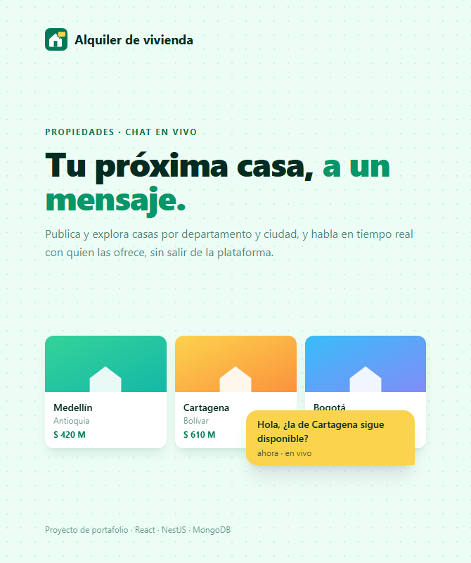

| | |
|---|---|
| **Producto** | Alquiler de vivienda |
| **Documento** | Manual de usuario |
| **Versión** | 2.0 · noviembre de 2026 |
| **Dirigido a** | Personas que buscan vivienda y personas que publican casas en alquiler |
| **Dirección** | [colombia-tech2.vercel.app](https://colombia-tech2.vercel.app) |
| **Autor** | Luis F. A. |

## Contenido

1. [Portada](#1-portada)
2. [Introducción](#2-introducción)
3. [Objetivo](#3-objetivo)
4. [Alcance](#4-alcance)
5. [Acceso al sistema](#5-acceso-al-sistema)
6. [Pantalla principal](#6-pantalla-principal)
7. [Navegación](#7-navegación)
8. [Funcionalidades](#8-funcionalidades)
9. [Gestión de perfil](#9-gestión-de-perfil)
10. [Mensajes frecuentes](#10-mensajes-frecuentes)
11. [Preguntas frecuentes](#11-preguntas-frecuentes)
12. [Glosario](#12-glosario)

---

## 2. Introducción

**Alquiler de vivienda** es una plataforma web para publicar y encontrar casas y apartamentos en
alquiler en Colombia. Quien publica sube los datos y la foto de la vivienda; quien busca explora el
catálogo por departamento y ciudad y conversa con los demás usuarios en un chat en vivo, sin salir
de la plataforma.

Funciona en el navegador del computador, la tablet o el celular, y se puede instalar como
aplicación. Este manual explica, paso a paso y con imágenes, cómo usar cada pantalla.

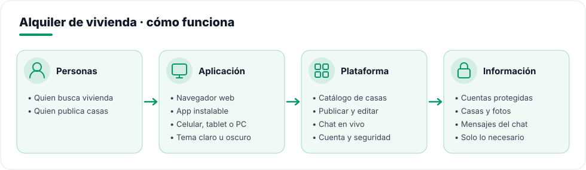

## 3. Objetivo

Que cualquier persona pueda, sin conocimientos técnicos:

- Crear su cuenta e ingresar de forma segura.
- Publicar, consultar, editar y eliminar casas en alquiler.
- Conversar en tiempo real con otras personas interesadas.
- Mantener al día su perfil y su contraseña.

## 4. Alcance

**Incluye:** registro e ingreso con verificación en dos pasos, catálogo de casas con búsqueda,
publicación y edición de casas con foto, chat general en vivo, perfil, cambio de contraseña y
métodos de verificación.

**No incluye:** pagos, contratos ni visitas agendadas; la plataforma pone en contacto a las
personas, y el acuerdo de alquiler se hace por fuera.

**Qué necesitas:** un navegador actualizado (Chrome, Edge, Firefox o Safari), conexión a internet,
un correo propio y una app autenticadora en el celular (por ejemplo, Google Authenticator o
Microsoft Authenticator) o acceso a tu correo para recibir códigos.

**Buenas prácticas:** el chat es una sala general; no compartas teléfonos, documentos ni datos
personales por ese medio. Publica la dirección general de la vivienda, no datos que te expongan.

## 5. Acceso al sistema

### 5.1 Crear una cuenta

En la pantalla de ingreso pulsa **Crea una**.

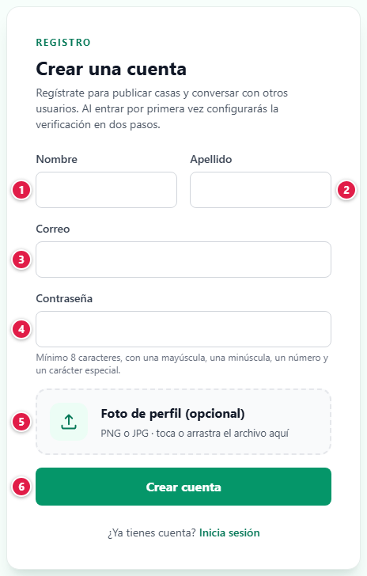

| # | Campo | Qué escribir |
|:-:|---|---|
| 1 | Nombre | Tu nombre |
| 2 | Apellido | Tu apellido |
| 3 | Correo | Un correo al que tengas acceso: lo usarás para entrar y para recuperar la cuenta |
| 4 | Contraseña | Mínimo 8 caracteres, con una mayúscula, una minúscula, un número y un carácter especial (por ejemplo `#` o `!`) |
| 5 | Foto de perfil | Opcional: una imagen PNG o JPG |
| 6 | Crear cuenta | Guarda tu cuenta y te lleva al ingreso |

### 5.2 Iniciar sesión

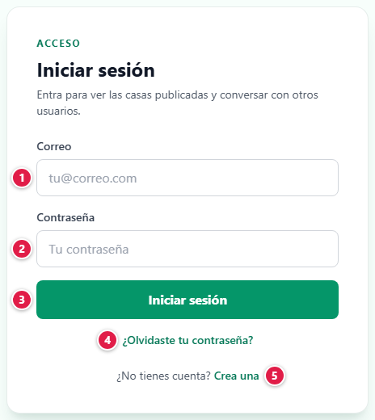

| # | Elemento | Qué hace |
|:-:|---|---|
| 1 | Correo | El correo de tu cuenta |
| 2 | Contraseña | Tu contraseña |
| 3 | Iniciar sesión | Comprueba tus datos y pasa a la verificación en dos pasos |
| 4 | ¿Olvidaste tu contraseña? | Abre la recuperación de contraseña (5.4) |
| 5 | Crea una | Abre el registro (5.1) |

### 5.3 Verificación en dos pasos

Cada ingreso pide, además de la contraseña, un código de 6 dígitos. La primera vez eliges cómo
recibirlo: con una **app autenticadora** (escaneas un código QR y la app muestra un código nuevo
cada 30 segundos, incluso sin internet) o con un **código por correo**.

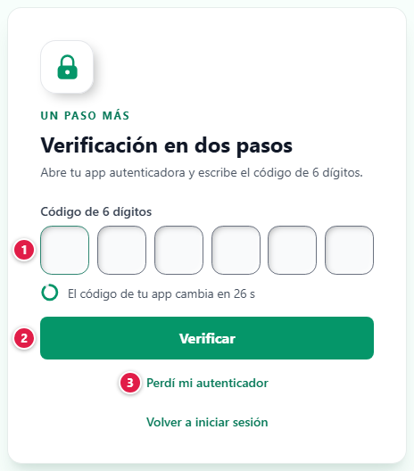

| # | Elemento | Qué hace |
|:-:|---|---|
| 1 | Código de 6 dígitos | Escribe el código de tu app o del correo; el círculo indica cuánto falta para que la app muestre uno nuevo |
| 2 | Verificar | Confirma el código y abre la plataforma |
| 3 | Perdí mi autenticador | Si ya no tienes la app, te envía un código al correo de tu cuenta para configurar una app nueva |

**Perdí mi autenticador:** pulsa el enlace, escribe el código que llega a tu correo y escanea el
nuevo código QR con tu app. La app anterior deja de servir en ese momento.

### 5.4 Recuperar la contraseña

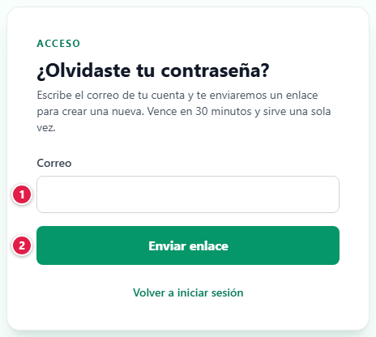

| # | Elemento | Qué hace |
|:-:|---|---|
| 1 | Correo | El correo de tu cuenta |
| 2 | Enviar enlace | Envía a ese correo un enlace para crear una contraseña nueva |

El mensaje de confirmación es el mismo exista o no la cuenta. Abre el enlace del correo (vence en
poco tiempo y sirve una sola vez), escribe la contraseña nueva y vuelve a ingresar. Tu verificación
en dos pasos sigue activa.

## 6. Pantalla principal

Al ingresar se abre **Casas publicadas**, el catálogo de viviendas.

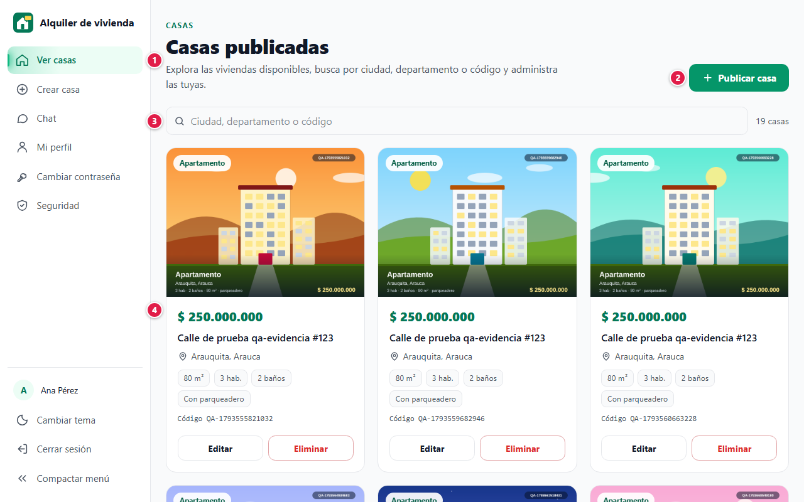

| # | Elemento | Qué hace |
|:-:|---|---|
| 1 | Menú lateral | Lleva a cada sección (ver 7. Navegación) |
| 2 | Publicar casa | Abre el formulario para publicar una vivienda (8.1) |
| 3 | Buscador | Filtra las casas por ciudad, departamento, tipo o código (8.2) |
| 4 | Tarjeta de casa | Foto, precio, dirección, ciudad, área, habitaciones, baños, parqueadero, código y los botones **Editar** y **Eliminar** |

Si una casa no tiene foto, la plataforma crea una ilustración con su tipo, ciudad, datos y precio.

## 7. Navegación

En el computador y la tablet en horizontal, el menú está a la izquierda. En el celular y la tablet
en vertical, pasa a una barra inferior; las opciones de la cuenta están en **Más**.

| Menú lateral (computador) | Barra inferior (celular) |
|:-:|:-:|
| 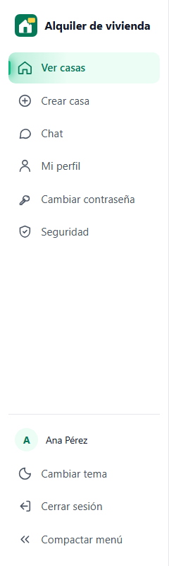 | 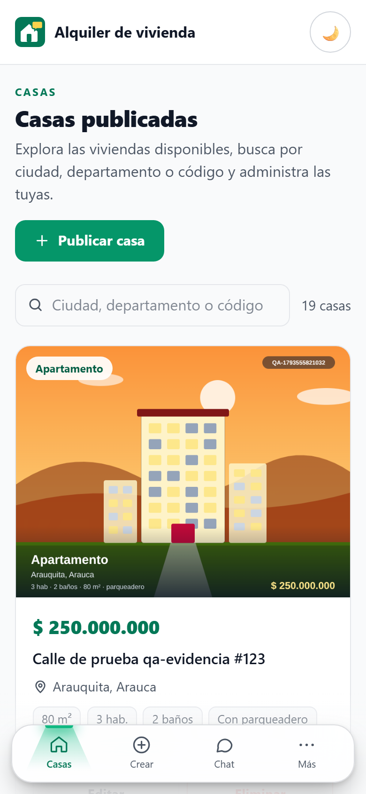 |

| Opción | Lleva a |
|---|---|
| Ver casas | El catálogo (pantalla principal) |
| Crear casa | El formulario para publicar |
| Chat | La sala de chat en vivo |
| Mi perfil | Tus datos personales y tu foto |
| Cambiar contraseña | El cambio de contraseña |
| Seguridad | Tus métodos de verificación en dos pasos |
| Cambiar tema | Alterna entre tema claro y oscuro |
| Cerrar sesión | Sale de la plataforma |
| Compactar menú | Deja el menú solo con íconos para ganar espacio |

Al pasar entre secciones, la pantalla cambia con una transición suave. La sesión se cierra sola
después de un tiempo sin actividad.

## 8. Funcionalidades

### 8.1 Crear: publicar una casa

**Crear casa** (o **Publicar casa** en el catálogo) abre el formulario, dividido en tres partes.

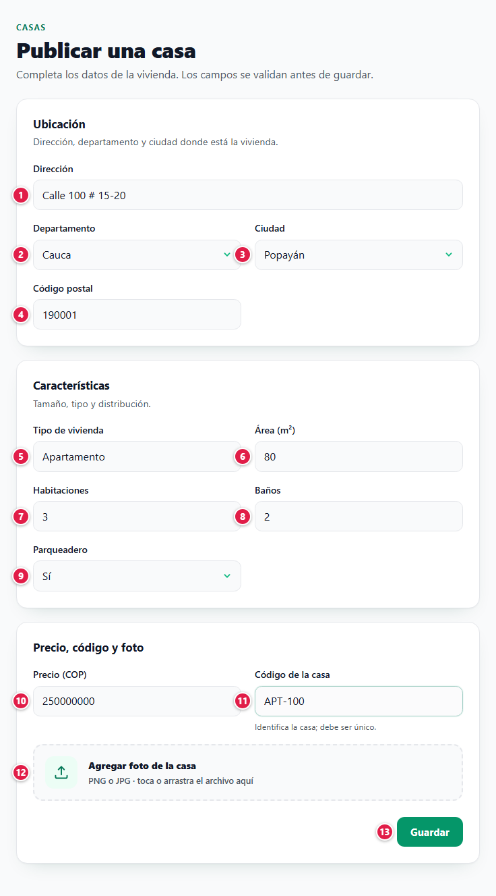

| # | Campo | Qué escribir |
|:-:|---|---|
| 1 | Dirección | Dirección de la vivienda |
| 2 | Departamento | Elige de la lista oficial de Colombia |
| 3 | Ciudad | Se habilita al elegir el departamento y muestra sus ciudades |
| 4 | Código postal | Código postal de la zona |
| 5 | Tipo de vivienda | Apartamento, casa, apartaestudio, finca… (puedes escribir otro) |
| 6 | Área (m²) | Metros cuadrados |
| 7 | Habitaciones | Número de habitaciones |
| 8 | Baños | Número de baños |
| 9 | Parqueadero | Sí o No |
| 10 | Precio (COP) | Precio en pesos, sin puntos |
| 11 | Código de la casa | Un código único para identificarla (por ejemplo, `APT-100`) |
| 12 | Foto | Opcional: PNG o JPG. Sin foto, se genera una ilustración |
| 13 | Guardar | Publica la casa y vuelve al catálogo |

### 8.2 Consultar: buscar casas y conversar

**Buscar.** Escribe en el buscador una ciudad, un departamento, un tipo o parte del código: el
catálogo se filtra al instante y a la derecha aparece cuántas casas coinciden.

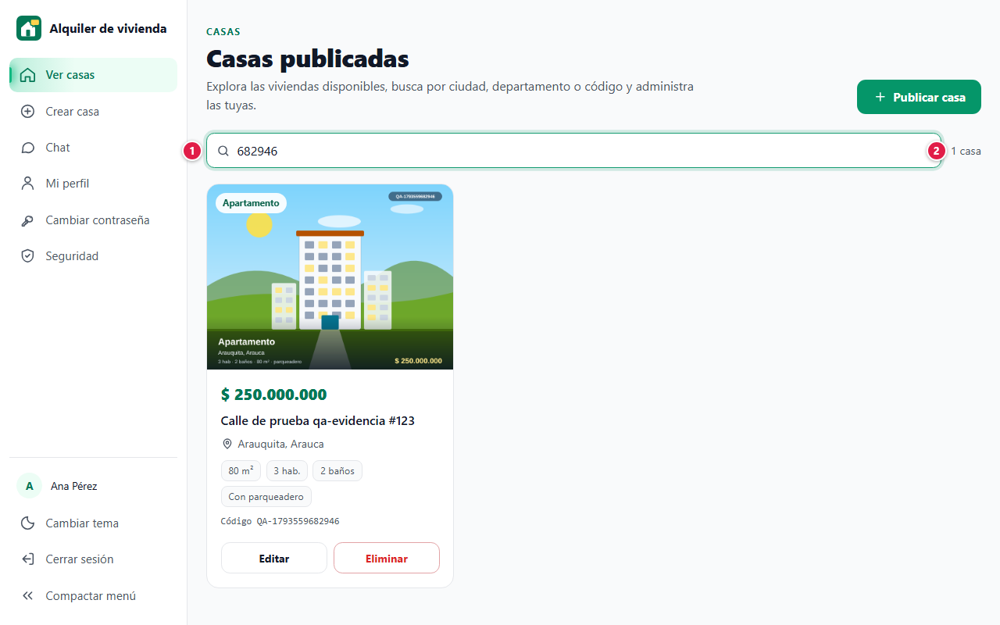

| # | Elemento | Qué hace |
|:-:|---|---|
| 1 | Buscador | Filtra mientras escribes; no distingue tildes ni mayúsculas |
| 2 | Conteo | Número de casas que coinciden con la búsqueda |

**Conversar.** **Chat** abre la sala general: los mensajes llegan al instante a todas las personas
conectadas y quedan guardados con su fecha y hora.

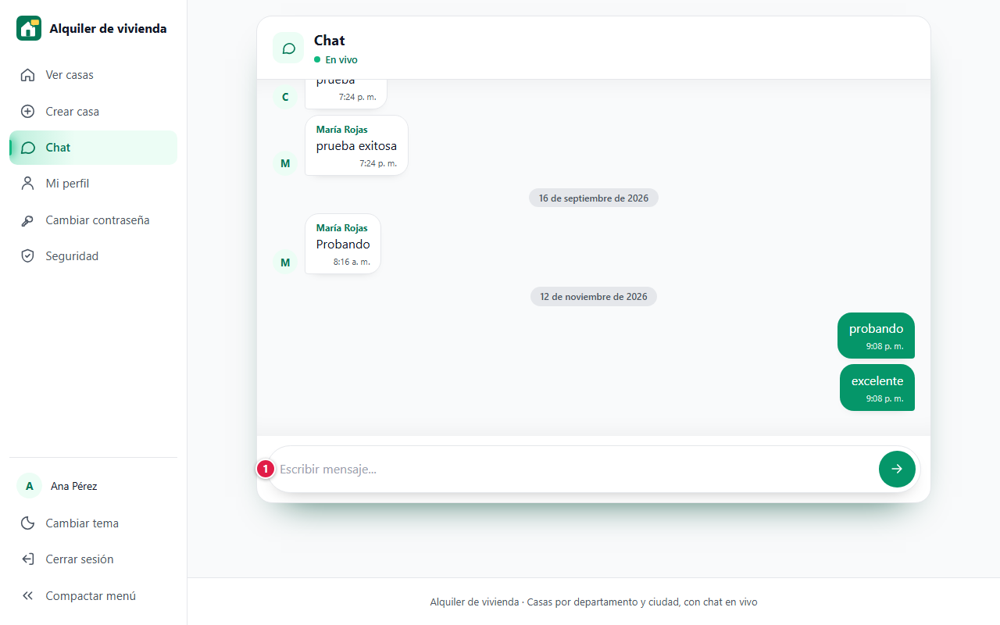

| # | Elemento | Qué hace |
|:-:|---|---|
| 1 | Escribir mensaje… | Escribe y pulsa el botón redondo (o Enter) para enviar |

### 8.3 Modificar: editar o eliminar una casa

**Editar.** En la tarjeta de la casa pulsa **Editar**: se abre el formulario con los datos cargados.

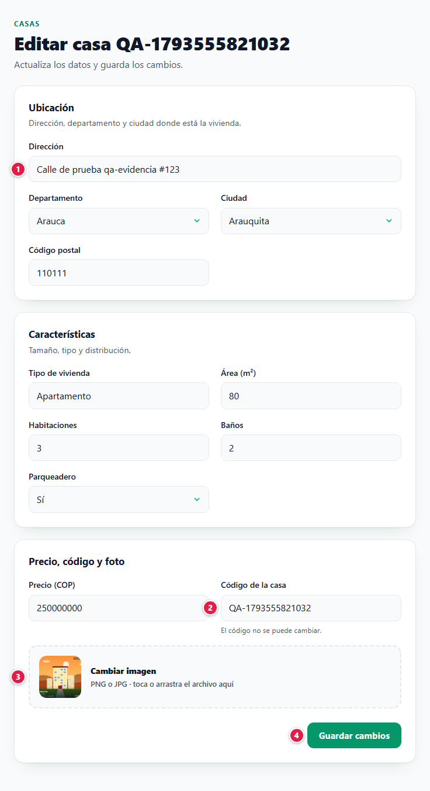

| # | Elemento | Qué hace |
|:-:|---|---|
| 1 | Campos de la casa | Cambia lo que necesites (dirección, ubicación, características o precio) |
| 2 | Código de la casa | No se puede cambiar: identifica la casa |
| 3 | Cambiar imagen | Reemplaza la foto; si no subes una, la ilustración se actualiza con los datos nuevos |
| 4 | Guardar cambios | Guarda y vuelve al catálogo |

**Eliminar.** En la tarjeta pulsa **Eliminar**. La plataforma pide confirmación: **Confirmar**
borra la casa y su imagen; **Cancelar** no hace nada.

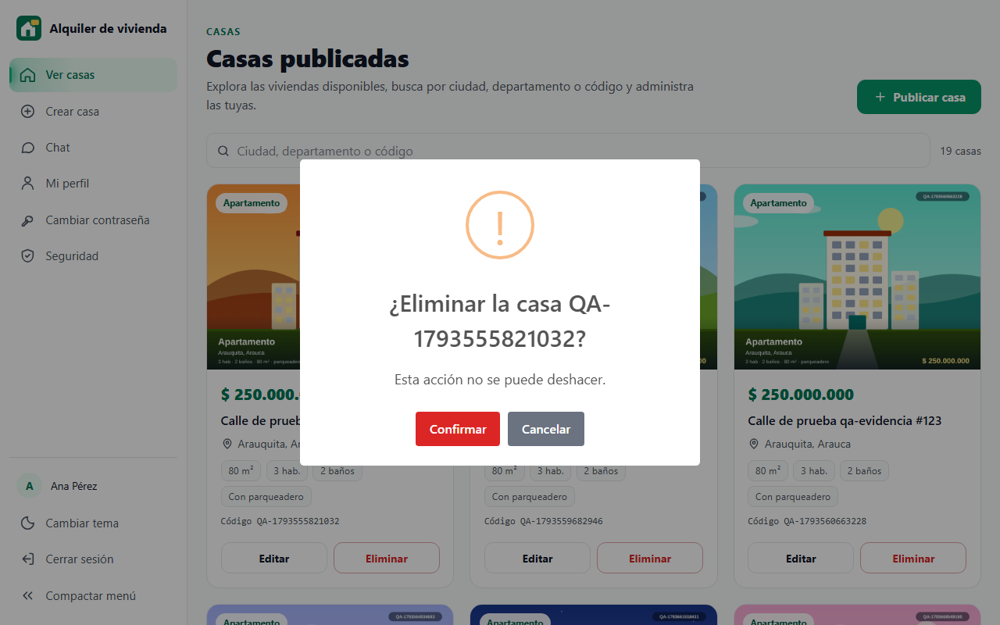

Solo quien publicó la casa puede editarla o eliminarla.

### 8.4 Reportar

La plataforma no genera reportes descargables. Para conocer el estado del catálogo usa el
**conteo de casas** junto al buscador (8.2), que muestra cuántas viviendas hay en total o cuántas
coinciden con una búsqueda.

Para **reportar un problema** (un error en la plataforma o una publicación indebida) escribe a:

- Telegram: [@lfac6](https://t.me/lfac6)
- WhatsApp: [@carraian160](https://wa.me/carraian160)
- Correo: [ariascluisf@hotmail.com](mailto:ariascluisf@hotmail.com)

## 9. Gestión de perfil

### 9.1 Mi perfil

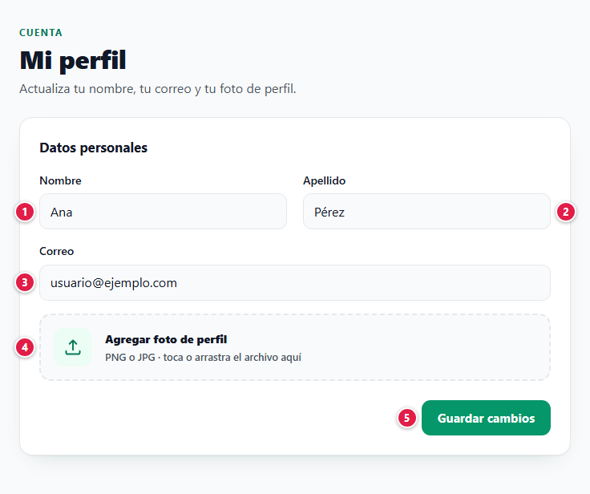

| # | Campo | Qué hace |
|:-:|---|---|
| 1 | Nombre | Tu nombre, como lo ven los demás en el chat |
| 2 | Apellido | Tu apellido |
| 3 | Correo | El correo con el que ingresas |
| 4 | Foto de perfil | Agrega o cambia tu foto (PNG o JPG) |
| 5 | Guardar cambios | Guarda los datos |

### 9.2 Cambiar contraseña

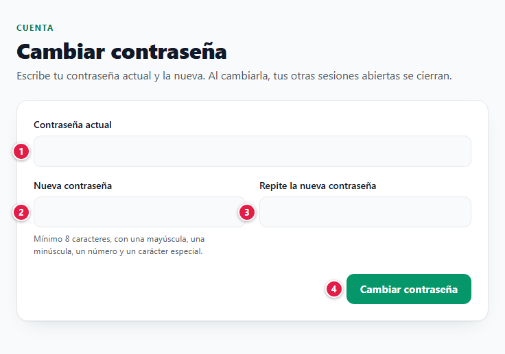

| # | Campo | Qué escribir |
|:-:|---|---|
| 1 | Contraseña actual | Tu contraseña de hoy |
| 2 | Nueva contraseña | Mínimo 8 caracteres, con mayúscula, minúscula, número y carácter especial |
| 3 | Repite la nueva contraseña | La misma contraseña nueva |
| 4 | Cambiar contraseña | Guarda el cambio; tus otras sesiones abiertas se cierran |

### 9.3 Seguridad

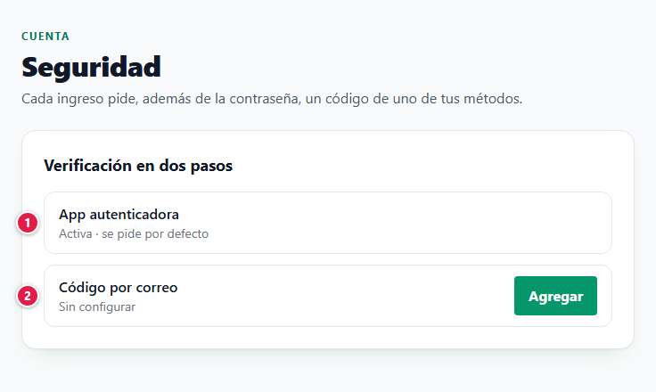

| # | Método | Qué puedes hacer |
|:-:|---|---|
| 1 | App autenticadora | Ver si está activa y si es el método que se pide por defecto |
| 2 | Código por correo | **Agregar** el método que te falta o **Pedir este por defecto** |

Tener los dos métodos activos te permite entrar aunque no tengas el celular a mano.

## 10. Mensajes frecuentes

| Mensaje | Qué significa | Qué hacer |
|---|---|---|
| Datos inválidos: revisa el correo y la contraseña. | El correo o la contraseña no coinciden | Revísalos; si no recuerdas la contraseña, usa **¿Olvidaste tu contraseña?** |
| Bienvenido | Ingresaste correctamente | Nada: ya estás en el catálogo |
| Casa Creada Correctamente | La casa quedó publicada | Búscala en el catálogo |
| La casa no pudo ser registrada | Falta un dato o el código ya existe | Lee el detalle del mensaje, corrige y guarda de nuevo |
| Casa Actualizada Correctamente | Los cambios quedaron guardados | Nada |
| Las contraseñas no coinciden | La contraseña nueva y su repetición son distintas | Escríbelas de nuevo |
| Contraseña actualizada correctamente | El cambio quedó guardado | Usa la contraseña nueva en tu próximo ingreso |
| El correo no tiene un formato válido | Falta la @ o el dominio | Escribe el correo completo |
| Estamos en mantenimiento | El servicio no responde en este momento | Espera: la pantalla vuelve sola apenas el servicio responda. No se pierde nada |
| No encontrada | La dirección escrita no existe | Usa el menú para volver |

## 11. Preguntas frecuentes

**¿Por qué la primera carga del día tarda un poco?** El servicio se suspende cuando nadie lo usa;
la primera acción puede tardar hasta un minuto mientras se reactiva. Después funciona con normalidad.

**¿Puedo editar la casa de otra persona?** No. Solo quien la publicó puede editarla o eliminarla.

**¿Por qué no me deja registrarme con mi contraseña?** Debe tener 8 caracteres o más, con
mayúscula, minúscula, número y un carácter especial.

**Cambié de celular y no tengo la app autenticadora.** Usa **Perdí mi autenticador** en la
pantalla del código (5.3).

**¿Se puede instalar en el celular?** Sí. En Android (Chrome): menú ⋮ → **Instalar aplicación**.
En iPhone (Safari): **Compartir** → **Agregar a pantalla de inicio**. En el computador (Chrome o
Edge): el ícono de instalar en la barra de direcciones.

**¿Dónde pido ayuda?** Telegram [@lfac6](https://t.me/lfac6), WhatsApp
[@carraian160](https://wa.me/carraian160) o [ariascluisf@hotmail.com](mailto:ariascluisf@hotmail.com).

## 12. Glosario

| Término | Qué significa |
|---|---|
| **App autenticadora** | Aplicación del celular que muestra un código nuevo cada 30 segundos para confirmar que eres tú |
| **Catálogo** | Lista de casas publicadas en la plataforma |
| **Código de la casa** | Identificador único que eliges al publicar una casa |
| **Código QR** | Imagen cuadrada que la app autenticadora escanea para quedar vinculada a tu cuenta |
| **Ilustración automática** | Imagen que la plataforma crea para una casa publicada sin foto |
| **Modo mantenimiento** | Pantalla que aparece cuando el servicio no responde; se quita sola |
| **Sesión** | Tiempo en que la plataforma te reconoce sin pedirte la contraseña otra vez |
| **Tema claro / oscuro** | Combinación de colores de la pantalla que puedes elegir |
| **Tiempo real** | Los mensajes aparecen al instante, sin recargar la página |
| **Verificación en dos pasos** | Además de la contraseña, se pide un código que solo tú puedes recibir |
